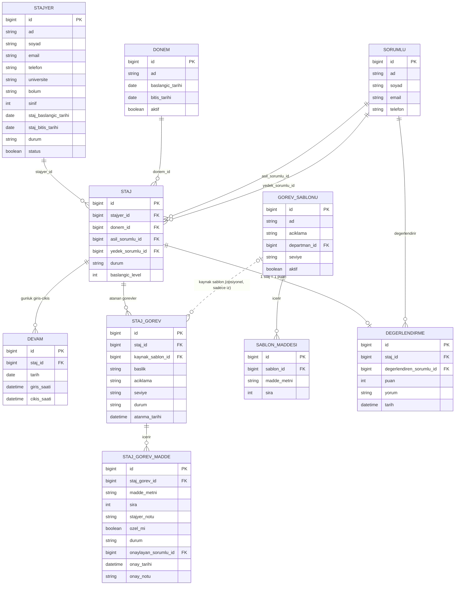

# Staj Envanter Projesi - ER Diyagramı

> Not: `StajyerApplication` tablosu kaldırılacağı için bu diyagrama dahil edilmemiştir.
> Devir sırasında yeni yedek sorumlu seçimi admin tarafından manuel yapılır (şema değişikliği gerektirmez).
> Değerlendirme kaydı girildiğinde `Staj.durum = TAMAMLANDI` olur ve `Devam` / `StajGorevMaddesi` üzerine yeni yazma işlemleri kilitlenir (iş kuralı, şema değişikliği değil).
> İlerleme çubuğu `StajGorevMaddesi.durum` alanına göre hesaplanır: bir `StajGorev` için tamamlanan madde sayısı / toplam madde sayısı (`TAMAMLANDI` + `ONAYLANDI` bitmiş sayılır, `REDDEDILDI` sayılmaz).
> **Madde bir soru değil, yapılacak iştir** ("JVM nedir, ne işe yarar"). Stajyer işi yapıp tamamlandı işaretler, sorumlu onaylar; `stajyer_notu` opsiyoneldir.
> `staj_gorev_madde.madde_metni` bir FK **değil**, `sablon_maddesi`'nden alınan bağımsız metin kopyasıdır (snapshot) — şablon değişse de atanmış görevler değişmez.

